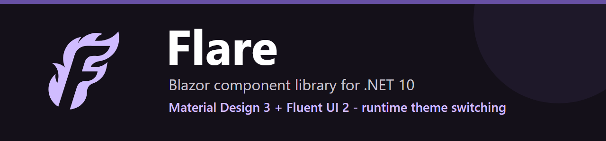

<p align="center">
  <a href="https://jrfrigat.github.io/Flare/">
    
  </a>
</p>

# Flare - Библиотека компонентов Blazor

<p align="center">🌐 <a href="README.md">English</a> · <b>Русский</b></p>

[](https://github.com/jrfrigat/Flare/actions/workflows/ci.yml)
[](https://www.nuget.org/packages/Flare.Blazor/)
[](https://www.nuget.org/packages/Flare.Blazor/)
[](https://dotnet.microsoft.com/)
[](LICENSE)
[](https://jrfrigat.github.io/Flare/)

Производственная, **не зависящая от тем** библиотека компонентов Blazor для **.NET 10** с **нулевым встроенным стилем**. Создавайте собственную дизайн-систему на семантических токенах или начните мгновенно с одной из семи готовых preset-тем (Material Design 3 Expressive, Material Design 3, Material Design 2, Fluent UI 2, Aero, Liquid Glass, Visual Studio 2026) - все поставляются как независимые, необязательные пакеты. Переключение тем во время выполнения без перезагрузки страницы и без мигания.

**Библиотека backend-разработчиков для backend-разработчиков.** Чтобы собрать на Flare любой экран -
дашборд, административный грид, мастер, редактор с разделителем, - знать HTML и CSS не требуется: все
собирается из компонентов и их параметров, без собственной таблицы стилей и без DevTools. При этом
ничего не заперто: любой визуальный аспект - семантический токен, который перекрашивает тема, а каждый
компонент пробрасывает `Class`, `Style` и произвольные HTML-атрибуты. Обе половины, на каждом
компоненте: первая - обещание, вторая - то, что не дает ему стать клеткой. Все, где первая половина не
выполняется, - дефект и заводится как дефект.

**[Живое демо / галерея компонентов ->](https://jrfrigat.github.io/Flare/)**

**190+ компонентов - своя тема на семантических токенах - 7 необязательных preset-дизайн-систем x 30+ палитр (+ Dynamic Color) x светлая/темная/авто - нет зависимостей от сторонних CSS**

---

## Возможности

- **190+ готовых к production компонентов** - ввод данных, макет, навигация, отображение данных, обратная связь, утилиты
- **Три независимые оси темы** - отдельно переключаются дизайн-система (MD3 Expressive / MD3 / MD2 / Fluent UI 2 / Aero / Liquid Glass / Visual Studio 2026), палитра и режим светлая/темная/авто, во время выполнения
- **Семь дизайн-систем отдельными пакетами** - подключаете только нужные темы; umbrella-пакет `Flare.Blazor` не содержит собственных тем
- **Доставка class-toggle** - переключение это смена классов на `<html>` (без переинъекции CSS-переменных на каждом переключении); есть запасной `ThemeDelivery.Inject`
- **Переиспользуемые палитры и генераторы** - встроенные наборы Material/Office/Aero/Liquid Glass/Visual Studio (30+ палитр) + `Palette.FromColors(id, name, seed)` для вывода полной палитры light+dark (MD3 тональный / Fluent рампа по активной теме)
- **Динамический цвет (Dynamic Color)** - опциональная палитра, выводимая во время выполнения из акцентного цвета ОС/браузера (акцент Windows/macOS, Android Material You через CSS-системный цвет `AccentColor`) генератором активной темы; откат на готовую `DynamicFallbackPalette` там, где реальный акцент недоступен - в частности Chrome/Edge, которые отдают фиксированный плейсхолдер, а не подлинный акцент (`opts.UseDynamicPalette = true`)
- **Автоматический темный режим** - `ThemeMode.Auto` следует за `prefers-color-scheme`; одностроковый бутстрап-скрипт убирает FOUC до первого кадра
- **Единый API цвета** - один параметр `Color` (`FlareColor`) у каждого компонента с цветом: семантическая роль (`FlareColor.Primary`) дает кэшируемый класс темы, либо любой произвольный цвет (`FlareColor.Custom("#E91E63")`) через инлайн-токены
- **Expressive-слайдер** - MD3 Expressive + Fluent в одном компоненте: размеры XS-XL, режим диапазона (два бегунка), вертикальная ориентация, индикаторы шагов, пузырек значения, иконки начала/конца, якорь заполнения (`Init`)
- **SVG-графики** - линейный, столбчатый, круговой и кольцевой с цветами темы, подсказками при наведении и легендой (без сторонних зависимостей)
- **Вложенная навигация** - группы навигации можно вкладывать, и они авто-раскрывают всю цепочку при активной дочерней ссылке
- **XML IntelliSense** - каждый `[Parameter]` каждого компонента имеет `/// <summary>` doc-комментарий
- **Полная интеграция EditContext** - валидация форм с `DataAnnotationsValidator` из коробки
- **Расширенный DataGrid** - множественная сортировка, изменение размера столбцов, выбор строк, редактирование в ячейке, экспорт CSV, группировка, виртуализация
- **Blazor Server - WASM - SSR** - JS-вызовы защищены от предварительного рендера
- **Без Bootstrap / без сторонних CSS** - все стили используют только токены `var(--flare-*)`

---

## Быстрый старт

```sh
dotnet add package Flare.Blazor
```

Flare не содержит собственных тем - каждая дизайн-система это отдельный пакет
`Flare.Theme.*`. Подключите нужные и зарегистрируйте их:

```sh
dotnet add package Flare.Theme.MaterialDesign3Expressive
dotnet add package Flare.Theme.FluentUI2   # добавьте любые другие пакеты тем
```

**`Program.cs`:**
```csharp
using Flare.Extensions;
using Flare.Theme.MaterialDesign3Expressive;
using Flare.Theme.MaterialDesign3.Tokens;   // Md3Palettes
using Flare.Theme.FluentUI2;

builder.Services.AddFlare(opts =>
{
    opts.DefaultTheme = new MaterialDesign3ExpressiveTheme();  // дизайн-система (тема = дизайн-токены)
    opts.DefaultPalette = Md3Palettes.Violet;                  // цвета (палитра несет light + dark)
    opts.DefaultMode = ThemeMode.Auto;                         // Light / Dark / Auto
});

// Зарегистрируйте остальные темы, которые должны быть доступны в рантайме. AddFlareTheme также
// принудительно загружает сборку темы (чего не делает простая ссылка в trimmed/WASM-приложении),
// поэтому он предпочтительнее автодискавери FlareOptions.RegisterAllBuiltInThemes. Каждая тема
// приносит свои палитры через ITheme.Palettes.
builder.Services.AddFlareTheme(new FluentUI2Theme());
```

**`index.html` / `App.razor` `<head>`:**
```html
<!-- Одна строка: классы темы + анти-FOUC сплэш до первого кадра. data-default-* задает тему,
     которую рисуем до старта .NET, - ту же, что регистрируете в Program.cs. -->
<script src="_content/Flare.Components/js/flare-bootstrap.js"
        data-default-theme="md3-expressive" data-default-palette="md3-violet"></script>
<!-- Стили компонентов -->
<link rel="stylesheet" href="_content/Flare.Components/css/flare-components.css" />
```

> Иконки - это inline-SVG, поэтому **иконочный шрифт подключать не нужно** - встроенный набор `FlareIcons`
> рисует дефолтный хром из коробки. Про опциональные пакеты провайдеров см. [Иконки](#иконки).

**Оберните ваше приложение:**
```razor
<FlareThemeProvider>
    <Routes />
</FlareThemeProvider>
```

---

## Переключение тем во время выполнения

Три независимые оси, переключаемые в рантайме:

```razor
@inject IThemeService ThemeService

await ThemeService.SetThemeAsync("fluent2");        // дизайн-система
await ThemeService.SetPaletteAsync("fluent-blue");  // цвета
await ThemeService.SetModeAsync(ThemeMode.Dark);    // Light / Dark / Auto

// чтение текущего выбора
var theme = ThemeService.CurrentTheme;
var palette = ThemeService.CurrentPalette;
var isDark = ThemeService.IsDark;
```

**Автоматический темный режим** встроен: при `ThemeMode.Auto` `FlareThemeProvider` следит за
системным `prefers-color-scheme`, а бутстрап-скрипт применяет его до первого кадра.

---

## API цвета

Каждый компонент с цветом принимает один параметр `Color` типа `FlareColor`:

```razor
@* Семантическая роль -> общий кэшируемый класс темы (учитывает тему, доступность) *@
<FlareButton Color="FlareColor.Primary">Primary</FlareButton>
<FlareProgressLinear Color="FlareColor.Success" Value="70" />

@* Произвольный цвет -> инлайн CSS-токены (с санитизацией) *@
<FlareSlider Color="FlareColor.Custom("#E91E63")" @bind-Value="_v" />
```

Работает и неявное преобразование из `string` (`Color="@Colors.Primary"`). Роли разворачиваются
в токены `--fc-main / --fc-on / --fc-container / --fc-on-container`; компонент читает только нужное
подмножество, поэтому MD3 и Fluent остаются согласованными автоматически.

---

## Иконки

Иконки - это **inline-SVG по умолчанию**: без иконочного шрифта, без сетевого запроса, без FOUT.
Встроенный набор `FlareIcons` (~90 иконок, пакет `Flare.Icons`) рисует дефолтный хром компонентов, а
каталоги провайдеров (Material Design 3, Material Design 2, Fluent UI 2, Font Awesome - SVG или
веб-шрифт) идут опциональными пакетами; SVG-пакеты помечены `IsTrimmable`, поэтому trimmed-публикация
Blazor WebAssembly приносит только те иконки, на которые вы ссылаетесь.

Полный гайд - [docs/ru/icons.md](docs/ru/icons.md).

---

## Компоненты

| Категория | Кол-во | Основные компоненты |
|-----------|------:|---------------------|
| **Ввод данных** | 18 | Button, Input, Checkbox, Switch, Radio, Select, Autocomplete, DatePicker, TimePicker, DateRangePicker, NumericField, Slider (одиночный + диапазон), Rating, FileUpload, ColorPicker, TagInput, InputMask, FormBuilder |
| **Макет** | 11 | Stack, Grid, Col, Container, Hidden, Layout, LayoutAppBar, LayoutDrawer, LayoutContent, Card, Divider |
| **Навигация** | 11 | AppBar, NavMenu, NavGroup, NavLink, Tabs, Tab, Accordion, Breadcrumb, Pagination, Stepper, Drawer |
| **Отображение данных** | 14 | DataGrid, Column, Table, VirtualList, InfiniteScroll, TreeView, DataTree, List, Timeline, Chart, Calendar, Kanban, Transfer, Carousel |
| **Обратная связь** | 9 | Dialog, DialogProvider, MessageBoxProvider, Alert, Snackbar, Progress, Skeleton, Tooltip, Overlay |
| **Дисплей** | 9 | Typography (FlareText), Avatar, Badge, Chip, Icon, Image, Link, Popover, ScrollTop |
| **Утилиты** | 5 | Menu, MenuItem, SpeedDial, SpeedDialAction, DropZone, RichTextEditor |
| **IDE** *(отдельный пакет)* | 6 | Ribbon, DocumentTabs, ToolPanel, Splitter, StatusBar, MenuBar |

---

## Архитектура

Onion-кольца, зависимости строго внутрь: `Flare.Abstractions` (порты, модель дизайн-токенов, реестр
имен CSS) <- `Flare.Theming` + `Flare.Infrastructure` (адаптеры) <- `Flare.Components` (только UI)
<- `Flare` (корень композиции, `AddFlare` связывает порты с адаптерами). Темы и опциональные семейства
компонентов идут отдельными пакетами, поэтому приложение подключает только нужное. Все компоненты
наследуют `FlareComponentBase`, который получает тему через каскадный `ThemeSnapshot` и прокидывает
`Class`, `Style` и произвольные HTML-атрибуты.

Карта модулей: [docs/ru/architecture.md](docs/ru/architecture.md)

---

## Галерея

Интерактивная галерея компонентов поставляется как **Blazor WASM PWA** с:
- Переключением языков EN/RU (кнопка в заголовке)
- Сворачиваемыми примерами кода с подсветкой синтаксиса для каждого раздела демонстрации
- Переключателем темы (дизайн-система x палитра x режим) с генерацией палитры из цвета

```sh
cd samples/Flare.Gallery
dotnet run
```

---

## Пользовательские палитры и темы

**Палитра** - это только цвета (light + dark): переиспользуйте дизайн-систему и поменяйте лишь цвета,
либо выведите полную палитру из одного бренд-цвета через `Palette.FromColors(id, name, seed)` вместо
ручного заполнения 45 ролей. **Динамический цвет (Dynamic Color)** подключает палитру, выводимую во
время выполнения из акцента ОС/браузера, а любой дизайн-токен переопределяется публичными
reference-записями. Полноценная кастомная **тема** = `DesignTokens` + дефолтная палитра (реализуйте
`ITheme`).

Руководство: [docs/ru/theme-creation-guide.md](docs/ru/theme-creation-guide.md) - модель системы тем,
пошаговый разбор и [Динамический цвет](docs/ru/theme-creation-guide.md#динамический-цвет-палитра-из-акцента-ос).

---

## Сборка и тестирование

```sh
dotnet build
# Один раз на машине и после обновления Microsoft.Playwright:
pwsh tests/Flare.Browser.Tests/bin/Debug/net10.0/playwright.ps1 install chromium
dotnet test         # Включает C# браузерные тесты Playwright
```

Браузерные тесты сами запускают и останавливают локальный Blazor-хост и Chromium без окна.
На Linux используйте `install --with-deps chromium`, чтобы установить и системные зависимости.
Отсутствие Chromium приводит к ошибке, а не пропуску тестов. При падении скриншоты и трассы
Playwright сохраняются в `tests/Flare.Browser.Tests/bin/<configuration>/net10.0/TestResults`.

CI запускается при пушах и pull request в `main`: сборка -> установка Chromium -> тесты -> упаковка NuGet.

Процесс для контрибьюторов - ветки, pull request, соглашения: [CONTRIBUTING.md](CONTRIBUTING.md).

---

## Документация

Вся документация - в **[docs/](docs/README.md)** (English + Русский).

| Документ | Языки | Описание |
|----------|-------|----------|
| [README.md](README.md) - [ru](README.ru.md) | EN - RU | README проекта |
| [getting-started](docs/ru/getting-started.md) - [en](docs/en/getting-started.md) | RU - EN | Установка, DI, стили, первый компонент |
| [icons](docs/ru/icons.md) - [en](docs/en/icons.md) | RU - EN | Система FlareIcon, встроенный набор, пакеты провайдеров, тримминг |
| [architecture](docs/ru/architecture.md) - [en](docs/en/architecture.md) | RU - EN | Карта модулей, паттерны компонентов, архитектура тем |
| [theme-creation-guide](docs/ru/theme-creation-guide.md) - [en](docs/en/theme-creation-guide.md) | RU - EN | Создание тем: дизайн-токены, палитры, кастомные темы |
| [component-conventions](docs/ru/component-conventions.md) - [en](docs/en/component-conventions.md) | RU - EN | Конвенции кода компонентов (CSS-токены, единый цвет, XML-доки) |
| [Full API Reference](docs/api/README.md) | EN | Сгенерировано автоматически на основе общедоступных сборок и XML-документации. Содержит подробные технические характеристики всех компонентов. |

---

## Лицензия

MIT (c) 2026 FrigaT
